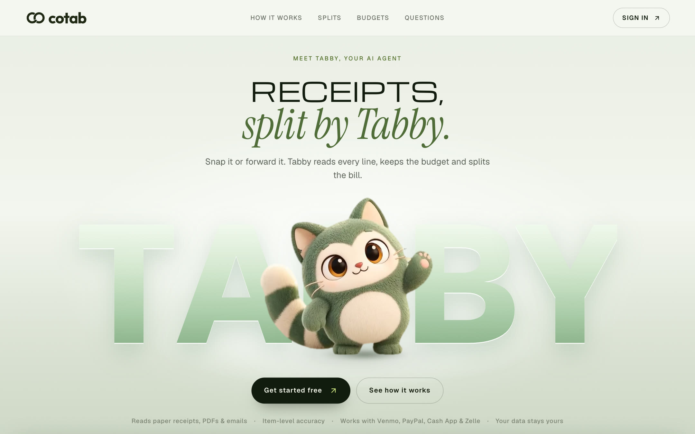
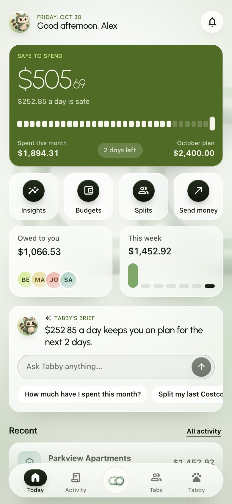
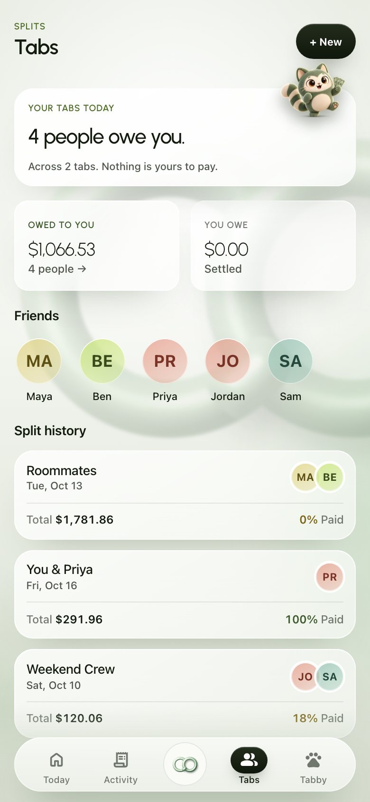
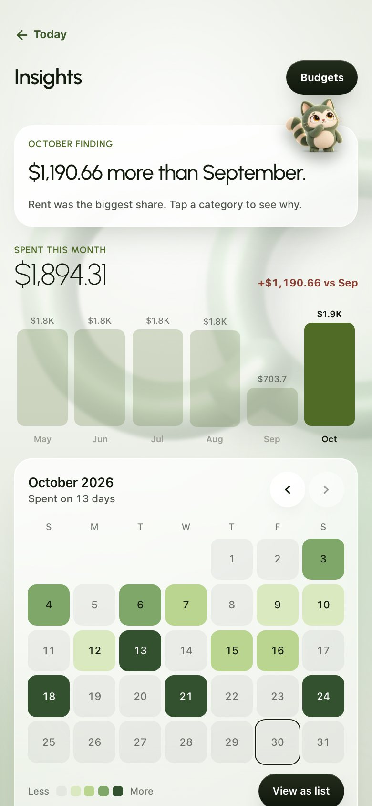
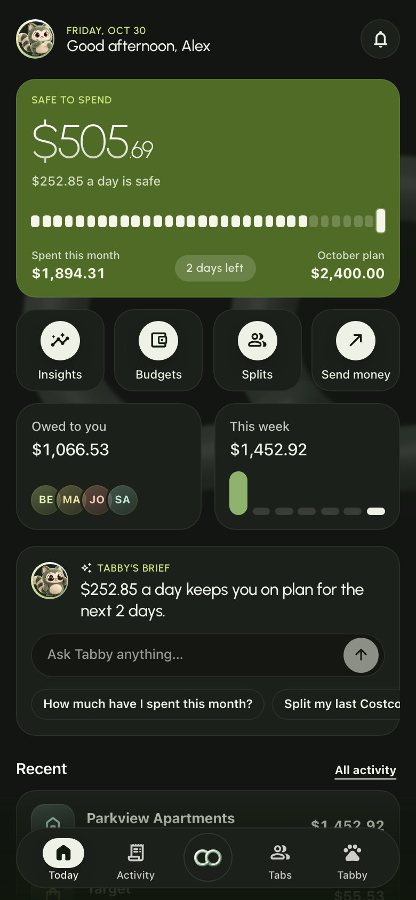
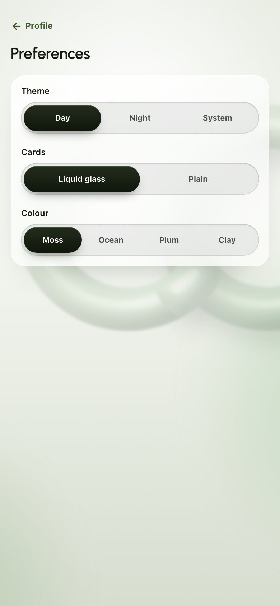
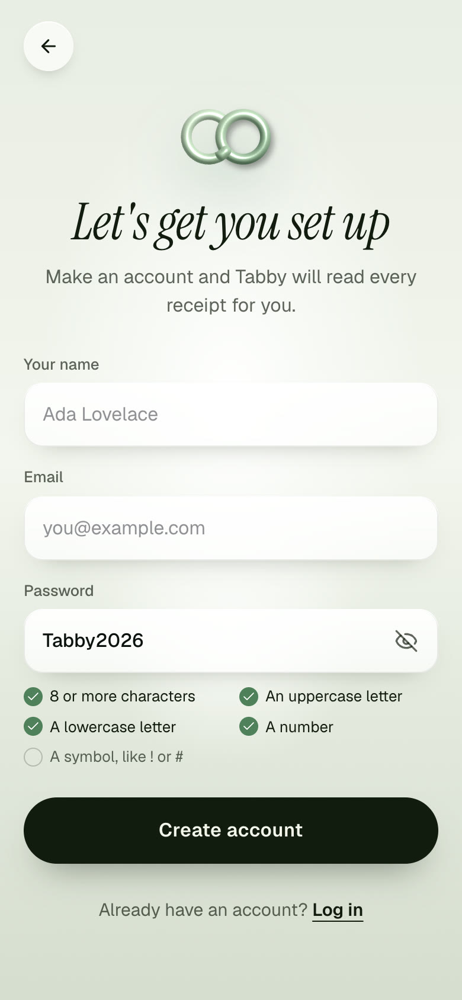
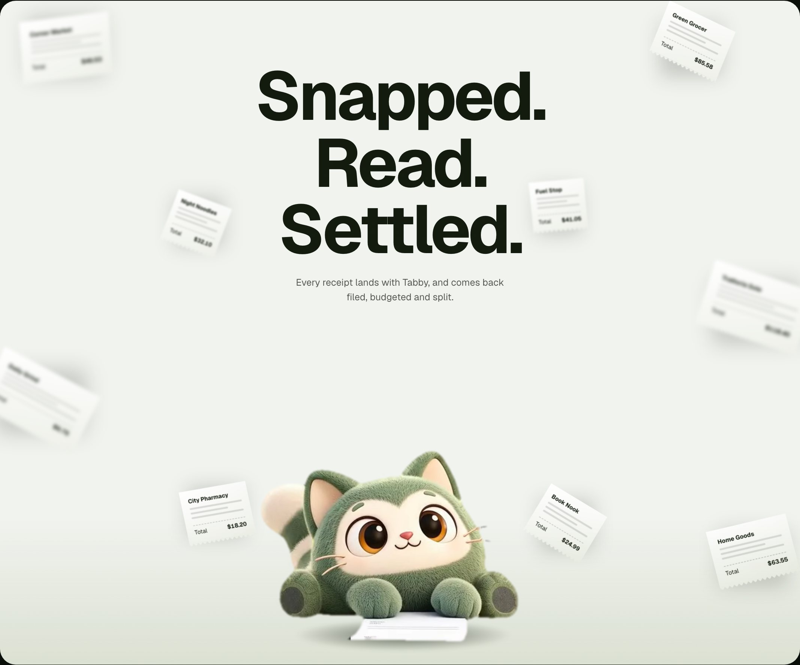
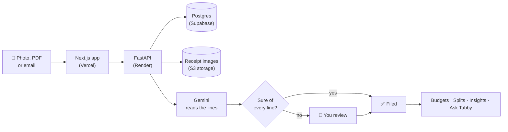
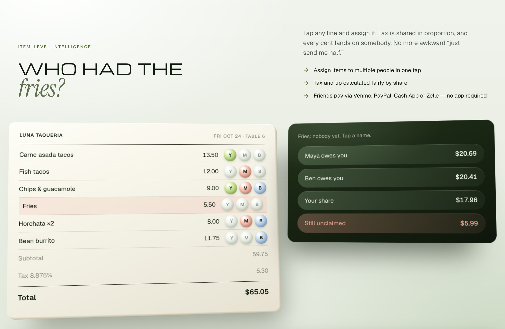

<div align="center">

<picture>
  <source media="(prefers-color-scheme: dark)" srcset="brand/01-svg/lockup/cotab-horizontal-flat-cream.svg">
  
</picture>

### Receipts, read for you.

Snap a receipt or forward the email. **Tabby**, Cotab's cat, reads every line,<br>
keeps your budgets honest and splits the bill with friends.

[](https://github.com/sriharichepuri21/Cotab/actions/workflows/frontend-ci.yml)
[](https://github.com/sriharichepuri21/Cotab/actions/workflows/backend-ci.yml)
[](https://cotab.center)

**[Try it at cotab.center](https://cotab.center)** ·
[What it does](#what-cotab-does) ·
[How it works](#how-it-works) ·
[Run it locally](#run-it-locally) ·
[Docs](#find-your-way-around)


</div>

<br>



## What Cotab does

| | |
|---|---|
| 📸 **Snap or forward** | Photograph a paper receipt, upload a PDF, or forward an email receipt to your own Cotab address. |
| 🧾 **Every line, read** | Tabby reads the shop, date, each item and its price, and checks them against the total. You confirm, then search for *oat milk*, not just *Trader Joe's*. |
| 🎯 **Budgets down to one item** | Plans for the month, a category, a shop or a single item, weekly, monthly or yearly. Tabby warns you before one runs out. |
| 🍟 **Fair splits** | Split evenly or line by line. Tax is shared in proportion and every cent lands on somebody. Friends need no account: they get a read-only link and pay with Venmo, PayPal, Cash App or Zelle. |
| 💬 **Ask Tabby** | Ask in plain words: *"How much did I spend on coffee in October?"* Answers come straight away. Any change waits for your yes. |
| 💸 **Settle up** | See who you owe and who owes you, open the bill behind any amount, and pay in Venmo, PayPal, Cash App or Zelle. Cotab never moves money: a payment counts once you record it. |
| 🗓️ **See where it went** | A spending calendar with a list view, six months of bars you can tap, and a breakdown by category. |
| 🎨 **Make it yours** | Day, night or system theme, liquid glass or plain cards, and four colours. |
| 🔔 **Nudges, not noise** | Budget alerts, reminders for friends who still owe, and a weekly summary, by push notification or email. |

<p align="center">
  
  
  
</p>
<p align="center"><sub>Home · Tabs · Insights</sub></p>

<p align="center">
  
  
  
</p>
<p align="center"><sub>Night theme · Preferences · Sign up with a strong password</sub></p>



## How it works


1. **You add a receipt.** The app compresses the photo on your phone, then uploads it to private storage.
2. **Tabby reads it.** Gemini vision pulls out the merchant, the total and every line item. Anything doubtful goes to a short review queue instead of straight into your numbers.
3. **You confirm.** The receipt is filed. Budgets, insights and any split it belongs to update at once.
4. **You ask, Tabby answers.** Chat runs on 17 typed tools. For open questions Tabby can write its own SQL, but only read-only queries that are parsed and checked first (with sqlglot), limited to approved tables and columns, scoped to your own data and rate-limited. Your user id is added on the server, so it cannot be forged, and any change waits for your yes.

<br clear="right">



<details>
<summary><b>See the split maths</b> (the "Who had the fries?" demo on the landing page)</summary>
<br>



Each line is divided between the people who had it. Tax is then shared in proportion to each person's subtotal, and the leftover cents go to the largest remainders, so the shares always add up to the receipt total exactly. The landing page version lives in [`frontend/src/components/landing/split.ts`](frontend/src/components/landing/split.ts); the app's own allocation and minimal-transfer settlement are in the backend split services.

</details>

## Run it locally

> [!TIP]
> **Fastest way:** one script starts everything with a year of sample data.

```bash
git clone https://github.com/sriharichepuri21/Cotab.git
cd Cotab
./scripts/demo-local.sh
```

Open **http://localhost:3010** and sign in with `demo+local@cotab.center` / `CotabDemo2026!`.
You need **Python 3.11+** and **Node 20+**. The API runs on `:8000`; if either port is taken, run `WEB_PORT=3020 API_PORT=8010 ./scripts/demo-local.sh`.

> [!IMPORTANT]
> Use `localhost`, not `127.0.0.1`. Browsers treat them as different sites, and your sign-in cookie only travels between matching ones.

<details>
<summary><b>Set it up by hand</b> (to work on the code)</summary>
<br>

**Backend** (FastAPI)

```bash
cd backend
python3 -m venv venv && source venv/bin/activate
pip install -r requirements.txt
cp ../.env.example .env          # add GEMINI_API_KEY to read real receipts
alembic upgrade head
uvicorn app.main:app --host localhost --port 8000 --reload
```

**Frontend** (Next.js)

```bash
cd frontend
npm install
cp .env.example .env.local
npm run dev                      # http://localhost:3000
```

API docs: **http://localhost:8000/docs**

No Docker, Postgres, Redis or AWS needed locally: it falls back to SQLite, an in-process rate limiter and a folder on disk for images.

</details>

<details>
<summary><b>Full stack with Docker</b> (Postgres, LocalStack, Redis)</summary>
<br>

```bash
docker compose -f docker-compose.dev.yml up
```

Not verified end to end yet.

</details>

<details>
<summary><b>Environment variables</b></summary>
<br>

Every variable is listed in [`.env.example`](.env.example) and read in [`backend/app/config/settings.py`](backend/app/config/settings.py). The ones you will meet first:

| Variable | What it does |
|---|---|
| `GEMINI_API_KEY` | Reads receipts and powers Ask Tabby. Without it, the app runs but cannot read new receipts. |
| `DATABASE_URL` | SQLite by default; Postgres in production. |
| `S3_*`, `AWS_*` | Where receipt images are kept. Falls back to `./local_data/objects`. |
| `RESEND_API_KEY`, `INBOUND_EMAIL_DOMAIN` | Email sending and the forward-a-receipt inbox. |
| `REDIS_URL` | Shared rate limits in production. |
| `AI_DAILY_BUDGET_USD`, `AI_USER_DAILY_BUDGET_USD` | Daily caps on AI spend, overall and per person. |

</details>

## Tests

| Suite | Count | Run it |
|---|---|---|
| Backend (pytest) | 857 tests | `cd backend && pytest -q` |
| Frontend unit (Vitest) | 186 tests | `cd frontend && npm test` |
| Browser (Playwright) | 51 tests | `cd frontend && npm run test:e2e` |

All three run in GitHub Actions on every push and pull request, along with formatting, linting and type checks.

## Built with

| Layer | Tools |
|---|---|
| **App** | Next.js 14 (App Router), React 18, TypeScript, Tailwind CSS, installable as a web app with push notifications |
| **API** | FastAPI, SQLAlchemy 2, Alembic, Pydantic, sqlglot |
| **AI** | Google Gemini (receipt vision and Ask Tabby); RapidOCR pipeline built in, switched off by default |
| **Data** | Postgres on Supabase in production, SQLite locally; S3-compatible storage for images |
| **Email** | Resend, for sending and for the inbound receipt inbox |
| **Hosting** | Vercel (app), Render (API), Supabase (database and storage), GitHub Actions (reminders and checks) |

## Find your way around

```
Cotab/
├── frontend/          Next.js app: landing page, sign-in, and the app at /app
│   ├── src/app/           pages and routes
│   ├── src/components/    UI, including newui/ (the app) and landing/
│   └── tests/e2e/         Playwright browser tests
├── backend/           FastAPI service
│   ├── app/api/v1/        HTTP endpoints
│   ├── app/services/      receipt reading, budgets, splits, Tabby's chat
│   ├── alembic/           database migrations
│   └── tests/             pytest suite
├── brand/             logo pack, app icons, social images, guidelines
├── docs/              the detailed docs below
└── DESIGN.md          colours, type and components, for people and agents
```

| I want to… | Read |
|---|---|
| Find where something lives | [docs/CODEBASE.md](docs/CODEBASE.md) |
| Understand how it all fits together | [docs/ARCHITECTURE.md](docs/ARCHITECTURE.md) |
| Call the API | [docs/API.md](docs/API.md) |
| Set up, test and debug locally | [docs/DEVELOPMENT.md](docs/DEVELOPMENT.md) |
| Deploy it | [docs/DEPLOYMENT.md](docs/DEPLOYMENT.md) · [docs/SUPABASE_S3.md](docs/SUPABASE_S3.md) |
| Build UI that looks like Cotab | [DESIGN.md](DESIGN.md) · [brand/README.md](brand/README.md) |
| Know what is unfinished | [Known gaps](docs/ARCHITECTURE.md#9-known-gaps--upgrade-paths) |

## Status

Cotab is live at **[cotab.center](https://cotab.center)** and in active development. Some pieces are built but not switched on yet, such as reading receipts with on-device OCR before falling back to Gemini. The honest list is in [Known gaps](docs/ARCHITECTURE.md#9-known-gaps--upgrade-paths).

## Licence

Copyright © 2026 Srihari Chepuri. **All rights reserved.** The code is public to read and learn from, but you may not copy, reuse, host or sell it, or use the Cotab name, logo or Tabby, without written permission. See [LICENSE](LICENSE).

<div align="center">
<br>

<br>
<sub>Made with paws by Tabby.</sub>
</div>
