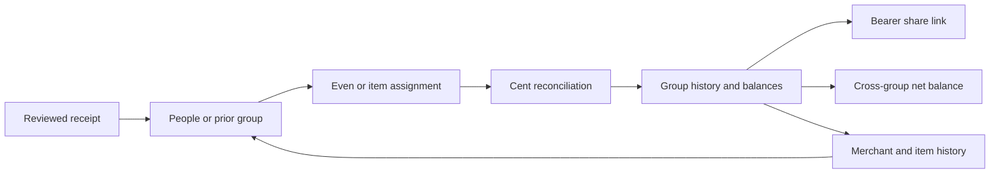

# ReceiptWise — Architecture

End-to-end reference for how the system is put together. For running it, see
[DEVELOPMENT.md](DEVELOPMENT.md); for shipping it, [DEPLOYMENT.md](DEPLOYMENT.md);
for endpoints, [API.md](API.md).

---

## 1. What it does

Photograph a receipt → an LLM extracts structured fields → you review and correct
→ ask questions about your spending in plain language → optionally split the bill
with people who don't have accounts.

Five capability areas:

| Area | Entry point | Core module |
|---|---|---|
| Receipt capture & extraction | `POST /api/v1/receipts/upload` | `services/gemini_service.py` |
| Conversational querying | `POST /api/v1/chat/` | `services/chat_service.py` + `chat_tools.py` |
| Budgets & reminders | `/api/v1/reminders/*` | `services/reminder_service.py` |
| Bill splitting | `/api/v1/splits/*` | `services/split_service.py` |
| Data portability | `/api/v1/exports/` | `api/v1/exports.py` |
| Dashboard & search | `/api/v1/analytics/summary`, `GET /api/v1/receipts/` | `services/analytics_service.py` + `receipt_query.py` |

---

## 2. Shape of the system

```
Browser (Next.js 14, App Router)
  │  light-compress to ~1MB WebP client-side before upload (server cap: 5MB)
  ▼
FastAPI  ── SQLAlchemy ──▶  SQLite (dev) / Postgres (prod)
  │
  ├──▶ Gemini API      (vision extraction + function-calling chat)
  └──▶ S3 / LocalStack (receipt images; falls back to local disk)

GitHub Actions cron ──▶ POST /api/v1/reminders/cron/*  (X-Cron-Secret)
```

Deliberately serverless-friendly: no queue, no worker, no background scheduler.
Extraction happens inline during the upload request, and reminders are driven by
an external cron hitting secret-guarded endpoints. This keeps it deployable on a
free Render web service, at the cost of a slow upload request (see
[§9 Known gaps](#9-known-gaps--upgrade-paths)).

---

## 3. Repository layout

```
backend/
  app/
    main.py                 FastAPI app, CORS, lifespan, prod config validation
    config/settings.py      Pydantic Settings — every env var lives here
    core/security.py        JWT issue/verify, bcrypt, X-Dev-User escape hatch
    db/
      session.py            Engines (rw + readonly), SessionLocal, Base
      s3.py                 Object storage w/ automatic local-disk fallback
    models/models.py        All 13 SQLAlchemy tables
    schemas/                Pydantic request/response models
    api/v1/                 Routers: auth, receipts, chat, reminders, splits, exports
    services/
      gemini_service.py     Vision extraction + chat tool declarations
      chat_service.py       Tool-calling orchestration loop
      chat_tools.py         The 6 callable tools (hand-written SQL)
      categories.py         Deterministic category alias normalization
      reminder_service.py   Digests, monthly reports, budget alerts
      split_service.py      Even/itemized splits, debt simplification
      ocr_service.py        RapidOCR wrapper (image -> tokens + boxes)
      ocr_rules.py          Row-reconstruction rule engine (OCR primary, gated OFF)
      ocr_packs.py          Merchant fingerprints + packs ("Kmart", "Costco", ...)
      extraction_service.py OCR-threshold gate -> Gemini fallback; records method
    utils/db_url.py         Postgres DSN normalization
  tests/                   166 tests (rules + chat + analytics + query + auth + migrations)
  scripts/                 Corpus dump; Gemini baseline; OCR-vs-Gemini measurement
frontend/
  src/app/page.tsx          Home: dashboard + filters + list + chat
  src/app/layout.tsx        Root layout
  src/components/           DashboardCards, SpendCharts, FilterBar, EmptyState
  src/lib/api.ts            Typed API client (auth, receipts, analytics, views)
docs/                       This documentation
.github/workflows/          backend-ci, frontend-ci, reminders-cron
render.yaml                 Render blueprint for the API
docker-compose.dev.yml      Full local stack (Postgres + LocalStack + both apps)
```

---

## 4. Data model

13 tables, all with `id: str` (UUID4), and all inheriting `TimestampMixin`
(`created_at`, `updated_at`, `deleted_at`).

**Soft delete is the rule everywhere.** `deleted_at IS NOT NULL` means deleted;
rows are meant to purge after `SOFT_DELETE_GRACE_DAYS` (default 30). Every query
in the codebase filters `deleted_at.is_(None)` — omitting that filter in new code
is the single easiest way to leak deleted data back into the UI.

Because that filter is on every read path, `deleted_at` is indexed on all
tables (`ix_<table>_deleted_at`). The mixin declares `index=True`; declarative
copies mixin columns per subclass, so each table gets its own index and the
names don't collide. `tests/test_migrations.py` asserts the migrated index set
matches the ORM's — a columns-only comparison silently passed once while every
one of these indexes was missing.

```
User ─┬─< Receipt ──< ReceiptLineItem
      ├─< Budget
      ├─< ChatSession ──< ChatMessage
      ├─< ExportRequest
      └─< SplitGroup ──< SplitMember
                    └──< ReceiptSplit ──< SplitShare
ReminderLog  (standalone; dedupe ledger, no FK)
```

### Notable columns

**`Receipt.status`** — the extraction state machine:
`uploaded → processing → extracted → reviewed`, or `failed`.
Spend aggregation only counts `extracted` and `reviewed`, so a `failed` receipt
never pollutes totals.

**`Receipt.category`** — one of ten canonical values, defined in **two places
that must stay in sync**: `gemini_service.CATEGORIES` (what the extractor may
emit) and `categories.CANONICAL_CATEGORIES` (what chat tools accept):
`groceries, dining, transport, utilities, rent, entertainment, health, shopping,
travel, other`.

**`ReceiptLineItem.user_id`** — denormalized from the parent receipt purely so
user-scoping filters never require a join.

**`ReminderLog.period_key`** — the dedupe guard (e.g. `2026-W31`). Before
sending, `has_been_sent()` checks `(user_id, kind, period_key)`. This is what
makes the cron endpoints safe to call repeatedly.

**`SplitMember.user_id`** — nullable by design. That null is the whole
"no accounts needed" feature: members are just names.

**`SplitGroup.share_code`** — a UUID serving as a bearer token for the public
read-only endpoint. Anyone holding the code can read the group.

**`Budget.level` / `target` / `period` / `amount`** — see §5.7. The column is
`amount`, not `monthly_limit`: once weekly and yearly periods exist, a field
named "monthly" is a lie on two thirds of the rows. Migration `e5b71c9a3f04`
carried the old `(category, monthly_limit)` rows over as monthly category
budgets.

**`SavedView.filters`** — the receipts-list query stored as JSON text, not a
column per filter. The filter surface is still moving and a migration per new
filter would be friction for no benefit; the blob is opaque to the DB and only
the frontend interprets it. Writes are filtered through an allowlist in
`api/v1/saved_views.py`, so a stored key the list endpoint doesn't understand
can't become a filter chip that silently does nothing.

**`ChatMessage.sql_used`** — vestigial. Left over from the text-to-SQL era; the
column still exists but is always written as `NULL` now. Safe to drop in a
future migration.

---

## 5. Request flows

### 5.1 Receipt upload

`POST /api/v1/receipts/upload` — [`api/v1/receipts.py`](../backend/app/api/v1/receipts.py)

1. Reject non-images (415) and anything over `MAX_UPLOAD_BYTES` (5MB) (413).
   The browser light-compresses the photo first (aiming for ~1MB WebP, starting
   at 1600px and stepping down) so upload is fast and the vision model gets
   enough detail for receipt text — it's a quality target, not a hard gate.
2. Insert `Receipt(status="processing")` so the row exists even if later steps die.
3. Upload bytes to S3 under `uploads/{user_id}/{uuid}.webp`. **Failure here is
   swallowed** — a missing object store must not lose the receipt.
4. Call Gemini vision with `EXTRACTION_PROMPT`, parse the JSON, populate merchant
   / totals / date / category / line items, set `status="extracted"`.
   Unrecognized categories are coerced to `other`.
5. Run budget alerts for the affected category.

Extraction is **synchronous**, so this request takes as long as the Gemini call.

### 5.2 Chat — the tool-calling loop

`POST /api/v1/chat/` — [`services/chat_service.py`](../backend/app/services/chat_service.py)

This is the most security-sensitive path in the app. Chat uses a hybrid tool
model: the six bounded domain tools remain the preferred fast path, while
schema-aware chat adds `line_items_search` and `execute_sql` for questions that
cannot be expressed through those tools. Schema-aware chat is enabled by default
in production (`EXECUTE_SQL_ENABLED=true`). The optional user-ID and email canary
lists remain available for staged rollout when the global flag is off.

```
message
  │
  ├─ per-user rate limit (Redis sliding window when REDIS_URL is configured)
  ├─ find-or-create ChatSession, persist the user turn
  ▼
loop, max MAX_ITERATIONS = 5
  │  Gemini returns either function_call parts or final text
  │  ├─ text  → break
  │  └─ calls → execute each via _call_tool(), feed results back
  ▼
persist assistant turn, return (session_id, None, answer)
```

The schema-aware path is read-only and user-scoped. `execute_sql` receives SQL
from Gemini, validates and rewrites it with `sqlglot`, then runs it on a separate
read-only database session. The allowlist contains only receipt, budget, split,
and chat data; the `users` table and authentication data are never exposed.
`SELECT *`, sensitive columns such as `tool_trace` and `raw_extraction`, unsafe
functions, locking clauses, DDL/DML, and non-SELECT CTEs are rejected. The
validator injects the authenticated `user_id`, clamps results to 500 rows, and
the executor applies a 10-second PostgreSQL statement timeout. Query results
return the executed SQL and row count for the frontend's “How was this answered?”
grounding view.

These properties do the security work:

1. **`user_id` is never a tool parameter.** It's not in any `FunctionDeclaration`,
   and `_call_tool` invokes `fn(db, user_id, **args)` with the *server's* value.
   Any `user_id` or `db` key the model tries to pass is stripped before the call.
2. **Model-generated SQL is confined to `execute_sql`.** Every other tool owns
   hand-written SQL; arbitrary SQL must pass the AST validator and read-only
   executor before it can reach the database.
3. **Tools never raise.** They return `{"status": "ok"|"empty"|"error", ...}`.
   Raw exceptions are logged server-side but only a generic `hint` reaches the
   model — exception text can leak schema details.
4. **The loop is bounded.** After 5 tool calls, `_force_final_text()` demands a
   textual answer, so a confused model can't burn quota indefinitely.

Error handling distinguishes three failure classes, which matters operationally:

| Condition | User sees |
|---|---|
| `GEMINI_API_KEY` unset | "Chat isn't configured on the server right now…" |
| `ResourceExhausted` (quota/429) | "I've hit my AI usage limit for now…" |
| Anything else | "I'm having trouble thinking right now…" |

All three log server-side via `logger.exception`/`logger.warning`. Before that
logging existed, an upstream 429 surfaced as a generic error while the server
recorded a clean `200 OK` — the failure was invisible.

#### The eight tools

Defined in [`chat_tools.py`](../backend/app/services/chat_tools.py), declared to
Gemini in `gemini_service._chat_tool_declarations()`. **Adding a tool means
editing both files plus `TOOL_REGISTRY`.**

| Tool | Required args | Notes |
|---|---|---|
| `get_spend_summary` | — | Defaults to last 30 days; totals + top 5 categories |
| `get_budget_status` | `category` | Spend vs limit for a month |
| `list_receipts` | — | Newest first; `limit` clamped to 1–50 |
| `find_receipts` | `search_text` | Searches merchant **and** line-item text |
| `create_split` | `receipt_id`, `member_names` | Even splits only |
| `add_budget` | `category`, `amount` | Upsert |
| `line_items_search` | `search_text` | Fast, parameterized line-item description search |
| `execute_sql` | `sql` | Arbitrary safe-schema analytics; SELECT-only, user-scoped, 500 rows / 10 seconds |

Category arguments always route through `categories._normalize_category()`, which
maps free text ("food", "Trader Joe's", "eating out") onto canonical values via
longest-alias-wins substring matching. It's deterministic and non-LLM, so it's
cheap and testable.

### 5.3 Reminders

Three cron endpoints guarded by `require_cron_secret` (an `X-Cron-Secret` header
check, reused from `exports.py`). GitHub Actions calls them on schedule.

| Job | Schedule (UTC) | `period_key` |
|---|---|---|
| Daily digest | `0 8 * * *` | per-day |
| Weekly digest | `0 19 * * 0` | `YYYY-Www` |
| Monthly report | `0 9 1 * *` | per-month |

Delivery is **log-only** today — `reminder_service._send()` prints. Telegram/email
adapters plug in there; `User.telegram_chat_id` already exists for it.

### 5.4 Splitting



[`split_service.py`](../backend/app/services/split_service.py) uses integer cents
and largest-remainder allocation. `$10 / 3` becomes `$3.34 + $3.33 + $3.33`,
never three independently rounded `$3.33` shares.

- **Even** divides the final receipt total exactly.
- **Itemized** allows one or several owners per item. Shared items divide their
  cents evenly; unassigned items fall back to the payer rather than disappearing.
- Tax, tip, discounts and OCR rounding are reconciled pro-rata, evenly, or to
  the payer according to `tax_mode`; shares always equal the receipt total.

`split_item_assignments` persists the evidence behind suggestions. Exact
normalized item descriptions at the same merchant produce an explicit confidence
score; automatic application starts only after three prior merchant examples.

`simplify_debts()` nets inside one group. `owner_net_balances()` merges balances
across groups by normalized email (falling back to name).

**Share-code security.** New codes are 128-bit random bearer capabilities. The
public endpoint is read-only, requires no account, and strips member emails.
Anyone holding the URL can view its financial summary.

Note the chat `create_split` tool always creates a **fresh single-purpose group**
per call ("one receipt, one split"), whereas the REST API lets you build a
persistent group and attach many receipts.

---

### 5.5 Dashboard and analytics

`GET /api/v1/analytics/summary` — [`services/analytics_service.py`](../backend/app/services/analytics_service.py)

One endpoint returns everything the home page needs (month total, top category,
top merchant, category and merchant breakdowns, 6-month trend, budget health,
pending-review count) rather than five, so a cold free-tier backend isn't hit
with a request waterfall.

**The aggregations live in one module on purpose.** `chat_tools.get_spend_summary`
reads from the same `spend_query`, because the dashboard and the assistant answer
the same question — if they ever quote different totals the user stops trusting
both. A test asserts the two agree.

Two rules are encoded there and apply everywhere money is summed:

- Only `extracted` and `reviewed` receipts count. An `uploaded` row has no total
  yet and a `failed` one never will.
- Month bounds are half-open, `[1st, next 1st)`, which avoids the last-day
  off-by-one that `<= end` invites.

The monthly trend is bucketed in Python rather than SQL: SQLite and Postgres
spell date truncation differently and the row count is tiny.

### 5.6 Filtering and search

`GET /api/v1/receipts/` — [`services/receipt_query.py`](../backend/app/services/receipt_query.py)

Every filter (`q`, `category`, `merchant`, `status`, date range, amount range,
sort, order, limit, offset) is optional and they AND together. `end_date` is
inclusive — someone picking the 31st means through the 31st — so it becomes an
exclusive bound one day later rather than silently dropping that day.

Search spans **merchant names and line-item descriptions**, because "did I buy
paper towels" is the real question and the answer is in the items. It is an
`OR` over the merchant plus an `EXISTS` subquery on line items, so a receipt with
two matching items is still one row.

**Dialect split.** On Postgres the text predicate is
`to_tsvector('english', …) @@ plainto_tsquery('english', …)`, backed by GIN
expression indexes created in migration `c31f8a4b7d92`. On SQLite it is `LIKE`.
Both branches are real: production is Postgres, but local dev and the whole test
suite are SQLite, so a Postgres-only implementation would leave the search path
untested and an unguarded migration would break `alembic upgrade head`
everywhere but production.

Expression indexes rather than a stored `tsvector` column: a materialized column
needs triggers or a generated column to stay in sync, and the query computes
`to_tsvector` inline anyway, so an index over the identical expression is what
the planner can actually use.

`GET /api/v1/receipts/facets` returns the distinct categories, merchants and
statuses this user actually has, so filter dropdowns only offer values that can
return rows. It is registered **before** `/{receipt_id}` or it would be captured
as an id.

### 5.7 Budgets and alerts

`GET/POST/PATCH/DELETE /api/v1/budgets/` — [`services/budget_service.py`](../backend/app/services/budget_service.py)

A budget is **(level, target, period, amount)**, unique per user on that scope:

| Level | `target` means | Spend counted |
|---|---|---|
| `total` | unused (empty) | every receipt in the period |
| `category` | a canonical category | receipts in that category |
| `merchant` | a substring | receipts whose merchant contains it |
| `item` | a substring | **matching line items only** |

Periods are `weekly` (Monday start), `monthly`, `yearly`, all half-open.

**Item budgets are measured on line items, not receipts.** A $50 coffee budget
must count the $4 latte on a $90 grocery receipt, not the whole $90. Every other
level sums receipt totals. Getting this wrong is the difference between a useful
budget and a nonsense one, so a test fails if it regresses.

**Thresholds fire on crossing, not on being over.** `check_after_upload` compares
against a snapshot taken *before* the receipt landed and reports only budgets
whose threshold band rose. Without that, every upload after the first overage
re-alerts and people learn to ignore them. Defaults are 80/100/120%.

`budget_service` is the single evaluator: the dashboard card, the `/budgets`
page, the post-upload toast and the reminder digest all read from it. A budget
that says 92% in one place and 78% in another is worse than no budget.

Category targets are normalized and validated at creation — `"food"` becomes
`"dining"`, `"zzz"` is a 422. A target that can never match would otherwise fail
silently at evaluation time as a budget that simply never moves.

`POST /receipts/upload` returns `ReceiptOut` **extended** with `budget_alerts`
(not nested under a key), so existing clients reading `.status` are unaffected.

> Email alerts (spec 4.4.5) are not implemented — they depend on Phase 6's email
> infrastructure. `reminder_service._send()` still only prints.

### 5.8 Bulk actions

`POST /api/v1/receipts/bulk` applies `categorize` or `delete` to many ids.
Ownership is enforced by filtering on `user_id` rather than looking each id up
and checking it: a forged id simply doesn't match, so it neither takes effect nor
reveals that the receipt exists. The response reports `requested` vs `updated`,
which is how a caller learns some were skipped. Delete is soft, like everywhere
else.

## 6. Auth

JWT bearer tokens (`python-jose`, HS256) with bcrypt password hashing.
Access tokens last `ACCESS_TOKEN_EXPIRE_MINUTES` (60). Only tokens whose
`type` claim is `access` authenticate a request. There are no refresh tokens:
they were issued but never used, and because the type was not checked, a
30-day refresh token worked as a full session. Login is limited per email
address (`RATE_LIMIT_LOGIN_PER_15MIN`, default 10) rather than per IP, because
behind Render's proxy every client can appear to share one address.

**Two interchangeable carriers.** [`core/security.py`](../backend/app/core/security.py)
`get_current_user` accepts the token from **either** an `Authorization: Bearer`
header **or** the httpOnly `rw_access` cookie, preferring the header when both
exist. The frontend uses the Bearer header (stored in `sessionStorage`, per-tab);
the cookie is the secondary path. See the post-mortem below for why.

**The `X-Dev-User` escape hatch** — [`core/security.py`](../backend/app/core/security.py):
sending `X-Dev-User: dev@local` authenticates as that email, **creating the user
if it doesn't exist**. It is accepted only when `ENVIRONMENT` is exactly
`development` (`settings.is_development()`), and the frontend additionally only
sends the header when `NODE_ENV !== "production"`.

> The gate fails closed: any other value, including typos such as `Production`
> or `prod`, disables the header. It previously keyed off
> `not is_production()`, which made any misspelling an unauthenticated
> account-creation endpoint.

The frontend has a real login flow: `/register`, `/login`, `/welcome` (onboarding
intent), and a client-side guard on `/` that calls `me()` and redirects to
`/login` on 401.

### Why Bearer tokens, not cookies — post-mortem

**What we discovered.** The first production version used only an httpOnly
cookie for auth. On the live cross-site deployment (`<app>.vercel.app` →
`receiptwise.onrender.com`) registration succeeded and the cookie was set with
all four correct attributes (`HttpOnly; Secure; SameSite=None`). But in Chrome
Incognito, subsequent calls to `GET /auth/me` and `POST /auth/set-intent`
returned **401**. DevTools showed the cookie **present in the jar** yet **absent
from the request headers**, with clean CORS and no console cookie warnings. The
cookie was being stored but blocked on **send**.

**Why.** Modern browsers treat a cross-site (`SameSite=None`) cookie as
third-party when the two hosts are on different registrable domains. Incognito
mode (and Safari/Firefox tracking prevention) blocks third-party cookies on the
*request* side even when the `Set-Cookie` on a `fetch` response is accepted for
storage. The result looks exactly like "login worked, every later call 401s,"
which is misleading: the frontend code and backend config were both correct.
The failure is browser policy, and it's increasingly the default, not the edge
case.

**The current design: Bearer-primary, cookie-secondary.** The frontend stores the
access token in `sessionStorage` and attaches it as a header on every request,
which no cookie policy blocks. The httpOnly cookie is **kept** (`credentials:
"include"` is still sent) so the same code path also works where cookies flow —
same-origin localhost dev, and a future **same-registrable-domain** deployment
(e.g. `app.example.com` frontend + `api.example.com` backend), where the cookie
is first-party and `SameSite=Lax` suffices. Backend is carrier-agnostic forever;
no auth change is needed to move back to cookies later. The tradeoff we accepted:
`sessionStorage` tokens are per-tab and XSS-readable, so this is a stepping-stone,
not the end state — the durable answer is same-domain httpOnly cookies.

---

## 7. Storage

[`db/s3.py`](../backend/app/db/s3.py) wraps boto3 with a `LocalStore` fallback:
every operation try/excepts to `./local_data/objects`. That's what lets the app
run end-to-end with no AWS and no LocalStack.

The tradeoff: a genuine S3 misconfiguration in production **degrades silently to
local disk** rather than erroring. On ephemeral hosts those files vanish on
redeploy. If uploads seem to work but images later disappear, check this first.

Set `S3_ENDPOINT_URL=""` for real AWS; point it at Supabase for S3-compatible
storage (see [SUPABASE_S3.md](SUPABASE_S3.md)).

---

## 8. Configuration

Every setting is declared in [`config/settings.py`](../backend/app/config/settings.py)
as a Pydantic `Settings` field; env var names are the upper-cased field names.
`extra="ignore"` means **unknown env vars are silently discarded** — a misspelled
or renamed variable doesn't error, it just doesn't apply. (That's exactly how
`docker-compose.dev.yml` came to be broken after `AWS_ENDPOINT_URL` was renamed
to `S3_ENDPOINT_URL`.)

| Var | Default | Purpose |
|---|---|---|
| `ENVIRONMENT` | `development` | `production` enables prod validation, disables dev auth |
| `DEBUG` | `true` | |
| `SECRET_KEY` | dev placeholder | JWT signing |
| `DATABASE_URL` | `sqlite:///./receiptwise.db` | `postgres://` is auto-normalized |
| `DATABASE_URL_READONLY` | falls back to `DATABASE_URL` | Read-role DSN |
| `CORS_ORIGINS` | localhost:3000 | Comma-separated |
| `S3_ENDPOINT_URL` | `http://localhost:4566` | `""` = real AWS |
| `AWS_ACCESS_KEY_ID` / `AWS_SECRET_ACCESS_KEY` | `test` | |
| `AWS_DEFAULT_REGION` | `us-east-1` | |
| `S3_BUCKET` | `receiptwise-uploads` | |
| `GEMINI_API_KEY` | — | Required for extraction and chat |
| `GEMINI_MODEL` | `gemini-3.5-flash` | |
| `RATE_LIMIT_CHAT_PER_HOUR` | `20` | Per-user chat budget |
| `RATE_LIMIT_UPLOAD_PER_HOUR` | `60` | Per-user uploads and retries (each is a paid vision call) |
| `RATE_LIMIT_LOGIN_PER_15MIN` | `10` | Login attempts per email address |
| `RATE_LIMIT_EXECUTE_SQL_PER_HOUR` | `30` | Separate per-user SQL-tool budget |
| `REDIS_URL` | — | Enables shared atomic sliding-window limits |
| `RATE_LIMIT_KEY_PREFIX` | `receiptwise:rate-limit` | Redis key namespace |
| `RATE_LIMIT_FAIL_CLOSED` | `true` | Reject expensive work when configured Redis is unavailable |
| `SOFT_DELETE_GRACE_DAYS` | `30` | |
| `MAX_UPLOAD_BYTES` | `5242880` | 5MB hard ceiling; client compresses toward ~1MB first |
| `CRON_SECRET` | dev placeholder | Guards `/reminders/cron/*`; production refuses to boot with the placeholder |

`Settings.validate_production()` runs at startup **only when
`ENVIRONMENT=production`** and hard-fails on: the placeholder `SECRET_KEY`, a
missing `GEMINI_API_KEY`, or a SQLite `DATABASE_URL`.

---

## 9. Known gaps & upgrade paths

Honest list of what's incomplete. Roughly ordered by how much it would hurt in
production.

### Blocking for real users

1. **OCR extraction engine is shipped but gated off.** Phase 2 added the full
   pipeline — RapidOCR (`ocr_service`), a generic rule engine (`ocr_rules`),
   per-grocer packs (`ocr_packs`), a threshold gate + Gemini fallback
   (`extraction_service`), and a `receipts.extraction_method` column — but
   `settings.ocr_engine_enabled` defaults to **false**, so every extraction today
   is still Gemini (Bearer cookie row `/images` preview also returns 501 on local
   dev storage). **Why gated:** real OCR tokenizes a receipt into many small
   fragments — labels and amounts land on *separate* tokens ("SUBTOTAL" and
   "24.99" are different lines), but the engine pairs a label with a price only
   when they share one token. It therefore misses subtotal/tax and recomputes
   line items on real receipts. **Remaining work:** row reconstruction — group
   OCR tokens by visual line (y-proximity), then pair a label with the right-most
   price in that row; line items follow the same grouping. The grocer packs
   (Costco/Walmart/Target/Trader Joe's) are written but **unverified against real
   OCR output** until row-grouping lands; they need re-tuning then. Fix before
   enabling: trust-anchored grouping + a real-receipt corpus check. This is the
   single highest-leverage upgrade — it is what actually cuts Gemini spend.
2. **Redis-backed rate limiting is implemented but awaits a production Redis
   URL.** When `REDIS_URL` is configured, chat and schema-aware SQL use atomic
   Redis sorted-set sliding windows shared by every API instance. Redis failures
   fail closed by default. Without a URL, development and the current production
   deployment retain a bounded in-process fallback, which resets on restart and
   is not suitable for horizontal scaling. Provision Redis before adding users
   or a second API instance.
3. **Gemini free tier is 20 requests/day** on `gemini-3.5-flash`, and one chat
   message costs 2+ calls (one per tool round trip). Real use needs billing
   enabled, or a higher-quota model.
4. **Schema-aware chat is the production default, but deliberately bounded.**
   `execute_sql` can answer arbitrary read-only questions over the safe user-data
   schema and returns SQL plus row-count grounding. It cannot access `users`,
   authentication secrets, blocked raw/trace columns, or non-allowlisted tables;
   it also cannot mutate data. The separate 30-query/hour SQL bucket uses the
   same Redis backend when configured. Monetary aggregates must stay grouped by
   currency unless the user explicitly requests conversion.

### Correctness / operational

5. ~~**No migrations.**~~ **Fixed.** The schema is now managed by Alembic
   (`backend/alembic/`). `create_all()` was removed from startup; migrations are
   applied via `alembic upgrade head` (Render runs this at boot). A baseline
   revision creates the base tables, and `tests/test_migrations.py` round-trips
   `upgrade head` / `downgrade base` against the ORM metadata.
6. **Silent S3 fallback** (§7) can mask a production misconfiguration.
7. **Synchronous extraction** makes upload latency equal to Gemini latency, with
   no retry. A queue (or a `failed` + retry path) is the upgrade.
8. **Exports are synchronous** and built in-memory in the request; large accounts
   will be slow. `ExportRequest.status` already models an async flow that isn't
   implemented.
9. **Reminders only print.** `_send()` is a stub.
10. **Two category lists** must be manually kept in sync (§4).
11. **`Budget.level` / `target` / `period` / `amount`** — see §5.7. The column is
`amount`, not `monthly_limit`: once weekly and yearly periods exist, a field
named "monthly" is a lie on two thirds of the rows. Migration `e5b71c9a3f04`
carried the old `(category, monthly_limit)` rows over as monthly category
budgets.

**`SavedView.filters`** — the receipts-list query stored as JSON text, not a
column per filter. The filter surface is still moving and a migration per new
filter would be friction for no benefit; the blob is opaque to the DB and only
the frontend interprets it. Writes are filtered through an allowlist in
`api/v1/saved_views.py`, so a stored key the list endpoint doesn't understand
can't become a filter chip that silently does nothing.

**`ChatMessage.sql_used`** is dead weight (§4).

### Deployment

> The API is live at https://receiptwise.onrender.com (Supabase Postgres +
> Storage) and the frontend is live at https://receiptwise-eight.vercel.app.
> Both were verified end-to-end (register → onboarding intent → upload → chat)
> in a clean incognito session. Deployment gotchas already hit (Python 3.14
> wheels, Supabase IPv6) are recorded in
> [DEPLOYMENT.md](DEPLOYMENT.md); the cross-site cookie → Bearer pivot is in §6.

12. **The reminder cron still fails** — `API_URL` is now set to the live API, but
    `CRON_SECRET` (a repo *secret*) is not, so the workflow sends an empty header
    and the endpoints correctly reject it with 401. Set it from the value in the
    Render dashboard: `gh secret set CRON_SECRET`.
13. **The frontend Dockerfile has never been built.** It was rewritten to use
    Next's `standalone` output and is unverified — CI runs `next build`, not
    `docker build`.
14. **`docker-compose.dev.yml` was broken** by the `AWS_ENDPOINT_URL` →
    `S3_ENDPOINT_URL` rename (now fixed, but the whole compose stack remains
    untested end-to-end).

### Product surface

14. The frontend now has routing, auth, receipt review, dashboard/search,
    saved views, bulk actions, budget CRUD, and complete split/group/share flows.
    Exports remain API-only; a dedicated review queue is also still missing.
15. **No frontend tests.** Backend has 201 tests; the frontend relies on lint,
    TypeScript and build checks rather than component/browser automation.
16. Not actually a PWA — no manifest, no service worker, no `public/`.
## 12. Contextual chat and proactive insights

The Phase 7 chat pipeline is deliberately split into bounded stages:

```text
question + page context
  → constrained reformulation
  → deterministic high-confidence routing hint
  → Gemini tool selection (last 10 messages supplied)
  → user-scoped, parameterized tool
  → answer + persisted tool trace
```

Page context contains only route-derived identifiers (`receipt_id`, `group_id`)
and never bypasses ownership checks in the tools. The frontend exposes chat as a
global drawer, so “what category is this?” on a receipt page can resolve “this”
without asking the user to copy an ID.

Mutation tools are a two-request protocol. Gemini can create an expiring
`ChatActionProposal`, but cannot execute it. Confirmation reloads the proposal by
both ID and user ID under a row lock, executes only an allowlisted tool with the
server-stored payload, and marks it executed. Repeated confirmation is idempotent;
cancelled or expired proposals cannot run.

Daily insights are deterministic, not generated prose: month-over-month change,
top-category concentration, two-standard-deviation receipt anomalies, and budget
threshold pressure. `dedupe_key` makes each observation idempotent per period.
Insights expire after 14 days and may be dismissed. “Tell me more” passes the
observation into the same contextual chat drawer.
